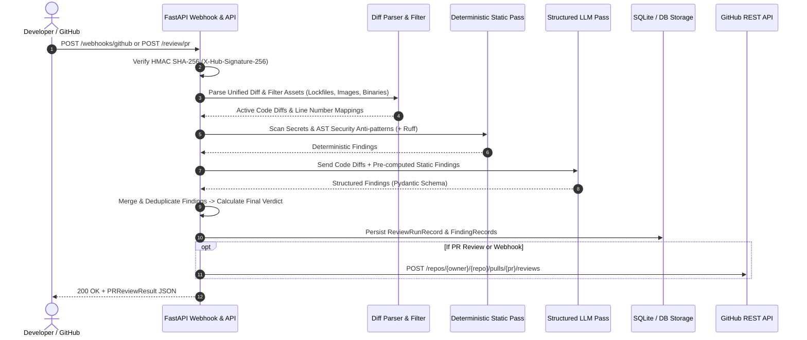

# 🤖 GitHub PR Reviewer & Code-Quality API

A backend-heavy developer tool that inspects GitHub pull requests and raw code diffs, executes deterministic static checks alongside an LLM pass, and returns structured, actionable review notes categorized by **bugs**, **security/edge cases**, **performance**, and **maintainability**—enforced with strict Pydantic v2 schemas.

---

## 🌟 Key Features

1. **Dual-Trigger Architecture**:
   - **GitHub Webhook Trigger (`POST /webhooks/github`)**: Listens to pull request events (`opened`, `synchronize`, `reopened`) with GitHub HMAC SHA-256 signature verification (`X-Hub-Signature-256`).
   - **Manual PR Trigger (`POST /review/pr`)**: Accepts a GitHub PR URL (e.g. `https://github.com/owner/repo/pull/42`) or repo + PR number.
   - **Direct Unified Diff Trigger (`POST /review/diff`)**: Accepts raw git diffs directly for local CI/CD pipelines, pre-commit hooks, or offline developer testing.

2. **Deterministic Static Pass (Fast & Free)**:
   - High-confidence secrets scanner detecting AWS keys, GitHub PATs, Slack tokens, private cryptographic keys, and hardcoded credentials.
   - Python AST security scanner flagging dynamic `eval`/`exec`, `subprocess(shell=True)`, SQL injection formatting, bare `except:`, and dangerous deserialization.
   - Subprocess `ruff` integration for instant mechanical lint and syntax checks.

3. **Structured LLM Review Pass**:
   - Generates structured, schema-compliant JSON outputs conforming to strict Pydantic models (`ReviewFinding`, `PRReviewResult`).
   - Configurable LLM backend: **Google Gemini**, **OpenAI**, or offline rule-based **Mock mode** (runs anywhere with 0 external API keys required).

4. **Post & Persist**:
   - Posts formatted GitHub Markdown review summaries and verdict badges (`APPROVE`, `REQUEST_CHANGES`, `COMMENT`) back to the GitHub PR using the GitHub REST API.
   - Persists all review run metadata, duration, token usage, and categorized findings into SQLite (or Supabase/PostgreSQL).

---

## 🏗️ Architecture & Request Flow



---

## 📁 Repository Structure

```
.
├── app/
│   ├── __init__.py
│   ├── main.py                  # FastAPI application entrypoint & lifespan
│   ├── config.py                # Pydantic BaseSettings & environment configs
│   ├── database.py              # SQLAlchemy engine & session dependency
│   ├── models/
│   │   ├── __init__.py
│   │   ├── schemas.py           # Pydantic v2 schemas (ReviewFinding, PRReviewResult)
│   │   └── db_models.py         # SQLAlchemy ORM models (ReviewRunRecord, FindingRecord)
│   ├── services/
│   │   ├── __init__.py
│   │   ├── diff_parser.py       # Unified diff parser & line number tracker
│   │   ├── static_analyzer.py   # Secrets regex & AST flaw analyzer (+ ruff)
│   │   ├── llm_service.py       # Gemini / OpenAI / Mock structured LLM service
│   │   ├── github_service.py    # GitHub API client & HMAC SHA-256 verification
│   │   └── reviewer.py          # Central pipeline orchestrator
│   └── api/
│       ├── __init__.py
│       └── routes.py            # API routes (webhooks, review, query, health)
├── tests/
│   ├── __init__.py
│   ├── conftest.py              # Test client, database fixture & test env setup
│   ├── test_diff_parser.py      # Diff parsing & ignore rules tests
│   ├── test_static_analyzer.py  # Secrets and security vulnerability tests
│   ├── test_webhook_verification.py # GitHub HMAC verification tests
│   ├── test_services.py         # LLM JSON parsing & Markdown formatting tests
│   └── test_api.py              # End-to-end API integration tests
├── .env.example                 # Environment variables template
├── requirements.txt             # Production & development dependencies
├── render.yaml                  # 1-click Render blueprint specification
├── Procfile                     # Process file for cloud web services
├── pytest.ini                   # Pytest configuration
└── README.md                    # Project documentation
```

---

## 🚀 Quickstart & Local Setup

### 1. Prerequisites
- Python 3.10+ (Tested on Python 3.14)
- Git

### 2. Clone and Setup Environment
```bash
git clone <your-repo-url>
cd <your-repo-directory>

# Create virtual environment
python -m venv .venv

# Activate virtual environment
# On Linux/macOS:
source .venv/bin/activate
# On Windows:
.venv\Scripts\activate

# Install dependencies
pip install -r requirements.txt
```

### 3. Configure Environment Variables
Copy `.env.example` to `.env`:
```bash
cp .env.example .env
```
Key configuration options:
- `LLM_PROVIDER`: Set to `mock` (default for offline testing), `gemini`, or `openai`.
- `GEMINI_API_KEY`: Your Google Gemini API key (when using Gemini).
- `GITHUB_TOKEN`: GitHub Personal Access Token (with `repo` permissions to post comments).
- `GITHUB_WEBHOOK_SECRET`: Secret configured in your GitHub repository webhook settings.

### 4. Run the API Server
```bash
uvicorn app.main:app --host 0.0.0.0 --port 8000 --reload
```
Navigate to **http://localhost:8000/docs** to open interactive Swagger UI.

---

## 🧪 Running Tests

Execute the comprehensive test suite with `pytest`:
```bash
pytest -v
```

---

## 📡 API Endpoints

### 1. Direct Diff Review (`POST /review/diff`)
Inspects a unified diff directly without requiring GitHub credentials.

**Request:**
```bash
curl -X POST http://localhost:8000/review/diff \
  -H "Content-Type: application/json" \
  -d '{
    "title": "Feature: Add User Endpoint",
    "diff_text": "diff --git a/app/user.py b/app/user.py\nnew file mode 100644\n--- /dev/null\n+++ b/app/user.py\n@@ -0,0 +1,5 @@\n+import subprocess\n+def run_cmd(user_arg):\n+    subprocess.run(\"echo \" + user_arg, shell=True)\n"
  }'
```

**Response (Summary):**
```json
{
  "id": "e36e4b85-515a-4ba4-9720-bc2f4ec13032",
  "verdict": "request_changes",
  "summary": "Reviewed 1 changed file(s). Found 1 issue(s) including critical/error-level defects that require changes before merging.",
  "findings": [
    {
      "file": "app/user.py",
      "line_hint": 3,
      "severity": "critical",
      "category": "security",
      "issue": "Dangerous invocation of subprocess with `shell=True`. High risk of Command Injection.",
      "suggested_fix": "Set `shell=False` and pass arguments as a list: `subprocess.run(['cmd', arg1], shell=False)`.",
      "source": "static"
    }
  ],
  "metrics": {
    "total_files": 1,
    "analyzed_files": 1,
    "filtered_files": 0,
    "static_findings_count": 1,
    "llm_findings_count": 0,
    "total_findings": 1,
    "tokens_used": 570,
    "duration_ms": 12.4
  }
}
```

---

### 2. Manual Pull Request Review (`POST /review/pr`)
Reviews an active pull request from GitHub by PR URL or repository name and PR number.

**Request:**
```bash
curl -X POST http://localhost:8000/review/pr \
  -H "Content-Type: application/json" \
  -d '{
    "pr_url": "https://github.com/octocat/Hello-World/pull/42",
    "post_to_github": false
  }'
```

---

### 3. GitHub Webhook Handler (`POST /webhooks/github`)
Configured in GitHub Repository -> Settings -> Webhooks:
- **Payload URL:** `https://<your-deployed-host>/webhooks/github`
- **Content type:** `application/json`
- **Secret:** Your `GITHUB_WEBHOOK_SECRET`
- **Events:** Select "Let me select individual events" -> check **Pull requests**

---

### 4. Query Past Reviews (`GET /reviews` and `GET /reviews/{review_id}`)
Retrieve historical review metrics, findings, and duration for auditability and developer dashboards.

---

## ☁️ Deployment Guide (Render - Zero Docker / Direct Git Push)

This repository is optimized for direct git-push deployment to **Render** without requiring Docker:

1. Push your code to a GitHub repository:
   ```bash
   git init
   git add .
   git commit -m "feat: Initial commit for GitHub PR Reviewer API"
   git remote add origin https://github.com/<your-username>/<your-repo-name>.git
   git push -u origin main
   ```
2. Log in to [Render.com](https://render.com) and click **New +** -> **Web Service**.
3. Select your GitHub repository.
4. Render will auto-detect the configuration, or set:
   - **Runtime:** `Python 3`
   - **Build Command:** `pip install -r requirements.txt`
   - **Start Command:** `uvicorn app.main:app --host 0.0.0.0 --port $PORT`
5. In **Environment Variables**, add:
   - `LLM_PROVIDER`: `gemini` (or `openai` or `mock`)
   - `GEMINI_API_KEY`: `<your-gemini-key>`
   - `GITHUB_TOKEN`: `<your-github-token>`
   - `GITHUB_WEBHOOK_SECRET`: `<your-webhook-secret>`
   - `DATABASE_URL`: `sqlite:///./pr_reviewer.db`
6. Click **Deploy Web Service**. Render builds the service directly from Git and provides a public HTTPS URL with automatic SSL!

